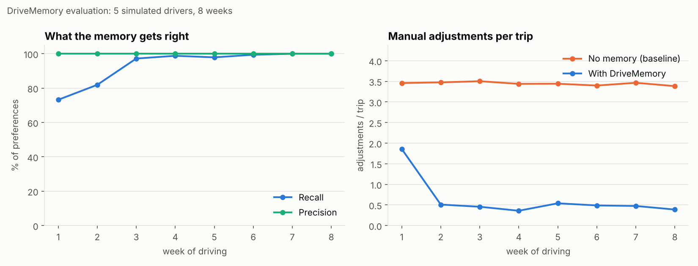
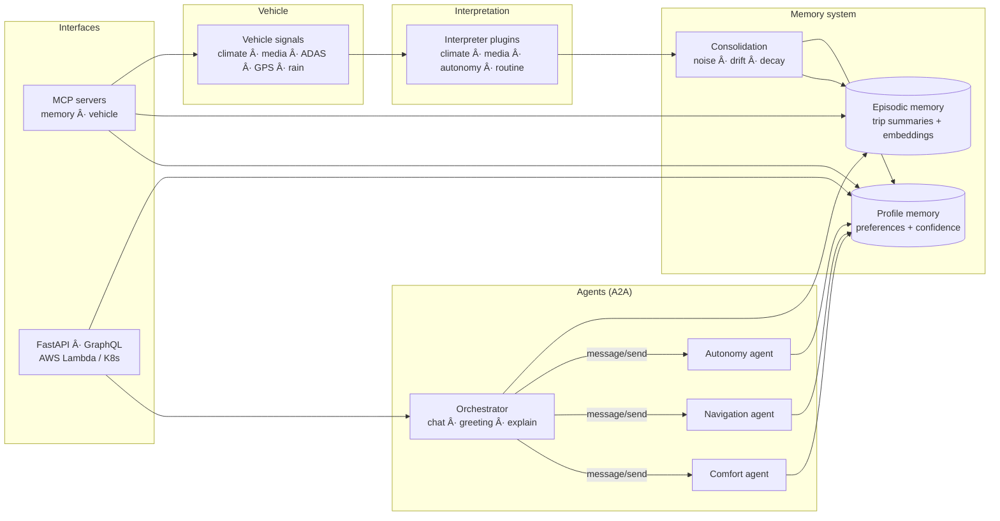

# DriveMemory

**A context-aware memory system for an in-car AI assistant.**
DriveMemory turns raw vehicle signals into explainable, privacy-respecting knowledge about the driver and uses it to personalise the cabin, the conversation and **autonomous-driving behaviour**, through a team of agents talking over **A2A** and tools exposed over **MCP**.

[](../../actions)


```text
Good morning! The cabin is set to 21.5°C, seat heating is on level 2 and news podcast is ready.
Heading to work? Rain is expected on the highway, so I'll give you an early, planned handover
before it starts.

You:        Why is it this temperature?
Assistant:  Because you usually set the cabin to 21.5°C. I've seen it on about 34 trips
            (confidence 95%). Most recently: cabin set to 21.5°C. You can say "forget that" any time.
```

## Why

An assistant that forgets you after every trip can't be personal. But "memory" in a car is hard:

* the evidence is **implicit**: nobody says "I like 21.5°C"; they just turn the dial;
* it's **noisy**: a passenger changes the temperature, a guest picks the music;
* it **changes**: habits drift, seasons change;
* it's **personal data**: the driver must be able to ask *why* and say *forget it*.

DriveMemory is a working prototype of that loop: **signals → observations → consolidated memory → personalised actions → explanations**. It is measured end-to-end against simulated drivers with known ground truth.

## Results

Evaluated on 5 simulated driver personas × 3 random seeds × 8 weeks (~120 trips each), on identical trips with and without memory (`python eval/run_eval.py`):



| Driver | Recall | Precision | Adjustments/trip (no memory → DriveMemory) | Drift adapted in |
|---|---|---|---|---|
| Anna (commuter, cautious in rain) | 100% | 100% | 3.55 → 0.31 | No drift |
| Ben (sporty, trusts autonomy) | 100% | 100% | 3.17 → 0.17 | No drift |
| Chen (no autonomy, likes it warm) | 100% | 100% | 3.35 → 0.26 | No drift |
| Dara (noisy shared car, 25% noise) | 100% | 100% | 3.95 → 0.88 | No drift |
| Emil (preferences change in week 4) | 100% | 100% | 2.90 → 0.32 | 3 weeks |

* **89% fewer manual adjustments** per trip once the assistant presets the cabin from memory.
* **73% fewer unplanned autonomy takeovers**: drivers who distrust autonomy in rain get a planned handover instead of a surprise.
* **80% of preferences learned within 2 weeks**. Precision stays at 100% because uncertain beliefs stay *candidates* instead of being acted on.
* **Drift is handled**: when Emil's preferences change, the old value is archived to history and the new one is adopted within ~3 weeks.

> ⚠️ These numbers come from a simulator I wrote, so they show that the *mechanics* work, not real-world accuracy. Real drivers are messier; see [Limitations](#limitations).

## Architecture



| Layer | What it does | Code |
|---|---|---|
| **Signals** | Catalog of 11 vehicle signals and a persona-based simulator that produces per-minute frames plus driver events (adjustments, takeovers) | `signals/` |
| **Interpreter** | Plugins turn raw frames into *observations* with context (`cold`, `morning`, `rain`) and evidence weight (explicit action = 1.0, implicit acceptance = 0.6). New signal = one small plugin | `interpreter/` |
| **Memory** | Episodic memory (trip summaries, vector search) + profile memory (preferences). Consolidation handles noise, drift, time decay, stated preferences, provenance and forgetting | `memory/` |
| **Agents** | A2A-style agents with agent cards and tasks. The orchestrator fans out to comfort, navigation and autonomy agents, merges recommendations into presets and a greeting, and handles chat | `agents/` |
| **MCP** | `drivememory-memory` (preferences, search, explain, remember, forget) and `drivememory-vehicle` (signals, state, simulation) | `mcp_servers/` |
| **API** | REST + GraphQL + A2A JSON-RPC endpoints; Lambda handler, Docker, Kubernetes, AWS SAM with least-privilege IAM | `api/`, `deploy/` |

### How memory works

Each preference is keyed by `(key, context)`, e.g. `climate.seat_heating @ cold` or `routine.destination @ tue-evening`.

* **Numeric** values (temperature, volume, following gap) keep a running estimate. A far-off value is treated as **noise**, unless **3 recent observations agree** with each other. Then it's **drift**: the old value moves to `history` and the new one is adopted.
* **Categorical / boolean** values keep **exponentially decayed counts**, so recent behaviour matters more.
* **Confidence** = evidence saturation × consistency, multiplied by **time decay** (45-day half-life). A preference must be **active** (confidence ≥ 0.55 and enough evidence) before an agent acts on it. Agents *apply* above 0.7 and only *suggest* below.
* **Stated preferences** ("I prefer 20 degrees") override observations, are marked `user_confirmed`, decay 4× slower, and need 5 contradicting observations to be overturned.
* **Explainability & privacy**: every preference stores its recent evidence (trip ids). `forget` deletes by domain or completely, and every drift, statement and deletion is written to an audit log.

### The autonomous-driving angle

The **autonomy agent** learns three things from ADAS signals:

1. whether the driver uses highway autonomy at all;
2. their preferred **following gap**, which is preset when autonomy engages;
3. their **trust in rain**, learned from takeovers when rain starts.

For drivers who take over in rain, the agent issues a **planned handover advisory** when rain is forecast, turning a surprise takeover into a calm, early one. Drivers who are comfortable in rain don't get nagged.

## Quickstart

```bash
git clone https://github.com/sandraesudhakaran-creator/drivememory.git
cd drivememory
python -m venv .venv && source .venv/bin/activate
pip install -e ".[all]"

drivememory demo --driver anna --weeks 4   # end-to-end walkthrough
drivememory chat --driver ben              # talk to the assistant
drivememory profile --driver emil --weeks 6
pytest -q                                  # 27 tests
python eval/run_eval.py --weeks 8          # reproduce the results above
```

Everything runs **offline with no API key**. Optionally `export ANTHROPIC_API_KEY=...` and the orchestrator uses an LLM to phrase greetings and to answer free-form questions, grounded only in the driver's memory (`DRIVEMEMORY_LLM_MODEL` selects the model).

### API (REST · GraphQL · A2A)

```bash
uvicorn drivememory.api.app:app --reload      # docs at http://localhost:8000/docs

curl -X POST "localhost:8000/drivers/anna/simulate?weeks=4"
curl -X POST localhost:8000/drivers/anna/trip-start \
     -H 'content-type: application/json' -d '{"outside_temp_c": 3, "rain_expected": true}'
curl -X POST localhost:8000/drivers/anna/chat \
     -H 'content-type: application/json' -d '{"text": "why is it so warm?"}'
```

GraphQL at `/graphql`:

```graphql
{
  driver(id: "anna") {
    preferences(domain: "autonomy") { id value confidence status description }
    search(query: "took over in the rain", k: 3) { timestamp summary score }
  }
}
```

A2A: agent cards at `/a2a/agents` and `/a2a/<agent>/.well-known/agent-card.json`. Tasks go via JSON-RPC `message/send` to `POST /a2a/<agent>`.

### MCP

Use the memory from any MCP client. For example, in Claude Desktop's `claude_desktop_config.json`:

```json
{
  "mcpServers": {
    "drivememory-memory":  { "command": "drivememory-memory-mcp" },
    "drivememory-vehicle": { "command": "drivememory-vehicle-mcp" }
  }
}
```

Then ask the client things like *"simulate 3 weeks for ben and tell me what you learned about his driving style"*.

### Deploy

```bash
docker compose up --build                          # local container
kubectl apply -f deploy/k8s/deployment.yaml        # Kubernetes / EKS
sam build -t deploy/aws/template.yaml && sam deploy --guided   # AWS Lambda + API Gateway
```

The SAM template creates a least-privilege IAM role: basic logging only, plus optional read access to a single Secrets Manager secret for the LLM key.

## Extending it: add a new vehicle signal

```python
from drivememory.interpreter import InterpreterPlugin, register

@register
class AmbientLightPlugin(InterpreterPlugin):
    name = "ambient_light"
    consumes = ("ambient_light_color",)

    def interpret(self, trip):
        color = trip.frames[-1]["ambient_light_color"]
        ctx = "night" if trip.departure.hour >= 19 else "day"
        return [self.obs(trip, "cabin.ambient_light", ctx, color, "categorical")]
```

Register the signal in `signals/catalog.py` and include it in your trip frames (from the simulator or a real data source). The memory, MCP tools, API and GraphQL then pick up the new preference automatically.

## Project structure

```text
src/drivememory/
├── signals/        # signal catalog, data models, persona simulator
├── interpreter/    # plugin framework + climate/media/autonomy/routine plugins
├── memory/         # episodes, preferences, consolidation, SQLite store, embeddings
├── agents/         # A2A protocol, specialist agents, orchestrator
├── mcp_servers/    # memory + vehicle MCP servers
├── api/            # FastAPI, GraphQL schema, Lambda handler
├── llm.py          # optional LLM layer (offline templates by default)
└── cli.py
eval/               # evaluation harness + results
tests/              # pytest suite
deploy/             # AWS SAM, Kubernetes
```

## Limitations

* **Synthetic data.** Personas and noise are designed by me, so the evaluation checks the mechanics, not real-world accuracy. Next step: validate on real CAN or driving logs (e.g. comma2k19) and with user studies.
* **Single driver per car.** Driver identification (key fob, phone, face ID) is assumed. Multi-occupant memory isn't modelled yet.
* **Rule-based consolidation.** It's deliberate, because it's explainable and testable, but an LLM-based consolidator for unstructured memories (e.g. from conversations) would be a natural extension.
* **Storage.** SQLite with a hashing-based embedding keeps setup at zero. For production, use Postgres + pgvector or DynamoDB with a real embedding model (`DRIVEMEMORY_EMBEDDINGS=sentence-transformers` is supported).

## Roadmap

- [ ] LLM-based extraction of memories from conversations ("my daughter has football on Tuesdays")
- [ ] Multi-driver profiles and passenger awareness
- [ ] Real driving-log ingestion adapter
- [ ] Streamable-HTTP MCP deployment behind the API
- [ ] Federated / on-device memory for privacy

## License

MIT
